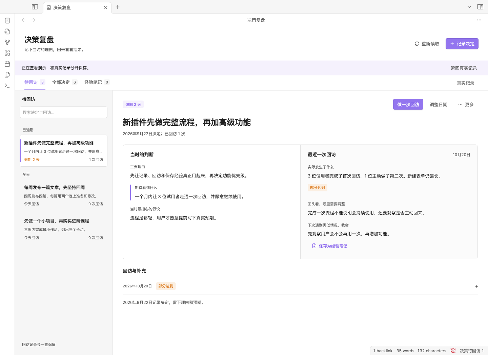

# Decision Review · 决策复盘助手

[English](README.en.md)

记录当时为什么这样选，回来看看实际发生了什么，再给下次留下经验。

**0.1.6 桌面预览版**，支持 Obsidian **1.8.7 及以上**，简体中文 / English。数据保存在库内 Markdown 文件中，无账号、联网或 AI 服务依赖。

本版修复停用插件后旧表单继续写入、旧设置请求覆盖新实例目录的问题，并处理启动时工作区尚未就绪的打开失败。详见 [停用与重载复查记录](docs/bug-audit-0.1.6.md)。

## 安装

1. 从 [GitHub Releases](https://github.com/fineuralab/obsidian-decision-review/releases/tag/0.1.6) 下载并解压 `decision-review-0.1.6.zip`。
2. 将其中的 `decision-review` 文件夹复制到 `<你的库>/.obsidian/plugins/`。
3. 确认该目录内直接包含 `main.js`、`manifest.json`、`styles.css`，不要多套一层文件夹。
4. 重新加载 Obsidian，在「设置 → 第三方插件」启用 **Decision Review**。
5. 点击左侧工具栏的书本勾选图标，或执行命令「Decision Review：打开决策复盘」。

```text
你的库/.obsidian/plugins/decision-review/
  main.js
  manifest.json
  styles.css
  LICENSE
  THIRD-PARTY-NOTICES.txt
```

更新时替换运行三件套后完整重载一次 Obsidian，清除旧版仍留在内存中的表单和回调。重载前先复制未保存的输入。真实数据留在库内数据目录，不随插件更新覆盖。本版尚未提交 Obsidian 社区插件目录；安装 ZIP 已构建，可以直接使用。源码 ZIP 需要先构建。

本次发布为桌面预览版，已在 macOS 的 Obsidian 1.8.7 中实测；Windows、Linux 和更新宿主版本尚未完成原生验收。

## 界面



[深色工作台](docs/screenshots/native-workspace-dark.png) · [窄面板](docs/screenshots/native-workspace-narrow.png) · [英文界面](docs/screenshots/native-workspace-en.png)

## 记录第一个决定

点击「记录决定」，填写三个必填内容：

- **这次做了什么决定**：例如「先做一个小项目，再购买进阶课程」。
- **主要理由**：写清楚当时为什么这样选择。
- **期待看到什么**：写下到时看到什么，会觉得这次选择值得。

决定日期默认今天，支持补记过去；回访日期默认建议 30 个自然日后，可以修改或清空。其他选项、最担心的假设、库内文件和网址放在可展开的「补充依据」内。从笔记触发新建时会预选当前笔记，可主动移除。

表单支持 Ctrl / Cmd + Enter 保存。关闭未保存的表单会询问是否放弃；保存失败时保留输入，显示具体错误。

## 到期回访与结果对照

「待回访」显示今天及逾期、且尚未结束的决定；「全部决定」也包含未来、未安排和已结束的记录。搜索覆盖决定、理由、预期、回访、补充与经验，状态过滤不会改变导航中的总数。

详情左侧是当时的判断，右侧是最近一次回访。窄面板改为上下对照，并通过「切换决定」搜索列表。

点击「做一次回访」，填写实际发生了什么，并主动选择「达到预期」「部分达到」「未达到」或「暂时无法判断」。可以补充判断哪里要调整、下次如何做，并关联证据。保存时明确选择：

- **继续观察，安排下次回访**：日期必须晚于今天。
- **继续观察，暂不安排日期**：保留观察状态，暂不提示。
- **结束回访**：保留全部记录，需要时可重新开启。

保存后保留当前详情，队列与数量同步更新。「调整日期」只追加安排，不制造空白回访。所有回访按发生日期与创建时间排序，同一天多次回访能正确展示最新一次。

## 原记录、更正与补充

首次记录保留。后来有新想法，使用更多菜单里的「补充想法」；输入需要纠正时，使用「更正原记录」，填写更正原因，另存新版本。默认对照首次版本，可以切换查看修订及变更字段。

每次回访会记住它参照的版本。展开历史可「更正回访」，旧文字和更正原因继续保留；更正不改变当前回访安排，也不会改写已保存的经验笔记。

## 资料与经验笔记

- **选择库内文件**：原生搜索库内笔记、图片、PDF 或其他文件。
- **添加网址**：接受 HTTP(S)，仅在用户点击时打开。
- **保存为经验笔记**：编辑标题与下次做法，生成独立 Markdown，包含来源决定与回访链接。

资料在 Obsidian 内移动或改名后，会更新当前和历史中的结构化路径。删除后仍保留引用并显示「链接失效」。插件关闭期间发生的移动无法可靠推断，请重新关联。

同一回访重复保存经验会打开已有笔记，避免重复生成。经验文件可自行编辑；回访更正后会提示其内容仍为保存时版本。原经验丢失时可主动另存一份。若经验已保存、但源决定的索引写入失败，错误会注明已有文件，重试会复用它。

## 数据与恢复

数据目录可在设置中指定，初次默认名按界面语言为「决策复盘」或 `Decision Review`；之后切换语言不改名、不迁移文件。请选择 Obsidian 可见的文件夹，路径中的任一部分都不能以点号开头。

```text
<数据目录>/
  决策-<稳定 ID>.md
  经验/经验-<决定 ID>-<回访 ID>.md
  演示数据/...
```

一决定一篇文件，YAML 属性保存结构化源数据，正文提供可阅读的记录与历史。将自己的自由笔记写在 `<!-- decision-review:notes -->` 以下，插件保存时原样保留。标记上方的正文由插件生成，请通过表单修改结构化记录。

保存前比较完整源文件，其他编辑已改动时会阻止旧表单覆盖，输入保留。复制未保存内容，关闭并重新打开表单再保存。YAML 损坏、ID 重复、缺失分隔标记或格式版本不支持时，界面显示具体文件并禁止覆盖；修复后点击「重新读取」。当前会话可显示上次成功读取的快照，并明确标记为待修复。

停用插件后，尚未保存的旧表单会保留输入并拒绝保存；重新启用也不会恢复该旧表单。复制输入，在当前实例中重新打开表单后保存。

从更多菜单「移到回收站」会将整个决定及其内嵌历史移到库内回收站，关联资料与独立经验笔记保留。卸载插件后，Markdown 文件仍可直接阅读。

演示与真实记录分开查看。清除演示只处理指定演示目录内、带演示标记的决定和经验，不移除用户自行放入的普通文件。真实使用请切回真实记录。

可使用自己的 Obsidian 同步或备份方式保存数据；多设备同时修改同一文件时，先解决同步冲突。本版不合并并发编辑。到期提示仅在插件内和可选状态栏显示。

## 设置与命令

设置包括界面语言、默认回访间隔（7 / 14 / 30 / 90 天）、数据目录、状态栏数量、载入与清除演示、重新读取。更改默认间隔不修改已有安排。手动更改目录设置不搬迁旧文件；在 Obsidian 内重命名当前数据目录时会同步它的位置。

命令包括「打开决策复盘」「记录一个决定」「查看待回访」「为当前决定做回访」「打开经验笔记」。回访命令优先匹配当前笔记关联的决定，多个时选择；没有匹配时从已有未结束决定中选择。

## 构建、测试与打包

需要 Node.js 22+、npm；打包另需 Python 3：

```sh
npm ci
npm test
npm run build
npm run package
```

`dist/` 输出可安装 ZIP、源码 ZIP、运行三件套和 `SHA256SUMS.txt`。安装包只包含运行文件和许可证，排除开发依赖、原型、临时库及个人配置。

详细结果见 [验收记录](docs/verification.md)。存储结构见 [数据格式](docs/data-format.md)，功能依据见 [首版设计](docs/design.md)。早期 [浏览器原型](prototype/index.html) 保留供对照，其浏览器数据不导入正式插件。

首版覆盖桌面深浅主题与窄面板。移动端专项适配、AI 建议、概率校准、自动归纳和多方案评分留待后续。

遇到问题或有改进建议，请提交 [Issue](https://github.com/fineuralab/obsidian-decision-review/issues)，附插件版本、Obsidian 版本、操作系统、复现步骤和预期结果。示例请使用不含个人信息的测试数据。

维护者：fineuralab。许可证：MIT。捆绑的 YAML 解析器使用 ISC 许可证，见 `THIRD-PARTY-NOTICES.txt`。
